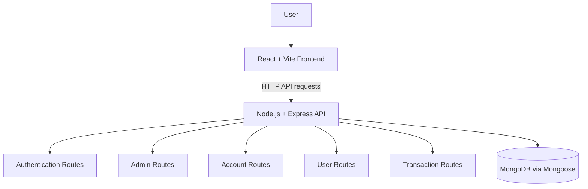
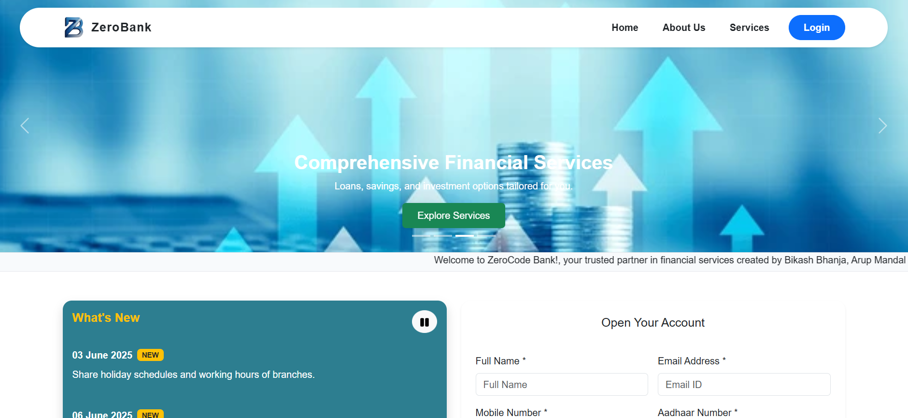

<!--
Zero Bank — Professional README
This is an alternate README. The original README.md is intentionally unchanged.
-->

<div align="center">

# 🏦 Zero Bank
### Digital Core Banking System

**A full-stack banking application built to explore digital banking workflows.**

[](https://react.dev/)
[](https://vite.dev/)
[](https://nodejs.org/)
[](https://expressjs.com/)
[](https://www.mongodb.com/)
[](#-license)

[Explore the Repository](https://github.com/Basudeb-Bej/Digital_core_Banking_System) · [Report an Issue](https://github.com/Basudeb-Bej/Digital_core_Banking_System/issues)

</div>

---

> [!IMPORTANT]
> **Educational / demonstration project.** Do not use this application to store real customer information or move real funds. Production banking systems require independent security testing, strong authorization and transaction controls, operational monitoring, and applicable legal and regulatory review.

## 📌 Overview

**Zero Bank** is a web-based digital banking project built with the MERN ecosystem. It combines a React single-page interface with a Node.js/Express API and MongoDB persistence to demonstrate common banking application workflows.

The repository includes backend route areas for authentication, administration, accounts, users, and transactions. The exact behavior and security of each workflow depend on the implementation in the source code.

### ✨ Project at a glance

| Area | Technologies / scope |
| --- | --- |
| User interface | React 19, Vite 7, React Router |
| UI components & charts | Bootstrap 5, React Bootstrap, React Icons, Recharts |
| API layer | Node.js, Express 5 |
| Data layer | MongoDB, Mongoose |
| Authentication-related packages | JWT, bcryptjs, express-session |
| Supporting utilities | dotenv, CORS, Multer, PDFKit, email-related packages |

## 🚀 Capabilities

- 👤 **User workflows** — API routes for user-related operations.
- 🧾 **Account workflows** — account-related endpoints and account-opening workflows.
- 🛡️ **Administrative workflows** — a dedicated route area for administration and approval operations.
- 🔐 **Authentication-related functionality** — authentication endpoints and supporting libraries.
- 💸 **Transaction workflows** — a dedicated transaction route area.
- 📊 **Data presentation** — charting support through Recharts.
- 📄 **Document support** — backend dependencies include PDF-generation utilities.
- ✉️ **Integration foundations** — dependencies for email delivery and file uploads are present.

> Feature lists describe the repository's current structure and dependencies, not a guarantee that every workflow is complete, secure, or production-ready. Confirm behavior in the source before relying on it.

## 🧭 Architecture

The following diagram summarizes the high-level stack described by the repository:



### 🗂️ Repository layout

```text
Digital_core_Banking_System/
├── README.md                     # Original README — left unchanged
├── README_PROFESSIONAL.md        # This enhanced documentation
└── ZeroCode/
    ├── front-end/                # React + Vite application
    └── back-end/                 # Express API, routes, models, configuration
```

## 🖼️ Screenshots & product tour

Suggested captures:
- **Dashboard** — the main landing view after sign-in.
- **Accounts** — account overview or account-opening workflow.
- **Transactions** — transaction history or transfer form using test data.
- **Administration** — administrative screen, if available.

<div align="center">

</div>

## ⚙️ Getting started

### Prerequisites

Install:
- [Node.js](https://nodejs.org/) — use an LTS release compatible with the project's dependencies.
- npm (included with Node.js)
- [MongoDB](https://www.mongodb.com/) — local instance or hosted database
- [Git](https://git-scm.com/)

### 1. Clone the repository

```bash
git clone https://github.com/Basudeb-Bej/Digital_core_Banking_System.git
cd Digital_core_Banking_System
```

### 2. Install and configure the backend

```bash
cd ZeroCode/back-end
npm install
```

Create a `.env` file in `ZeroCode/back-end/` and add the variables required by the backend configuration. Check the source code for the exact variable names; do not assume example names are supported.

**Security:** never commit passwords, API keys, tokens, private keys, or database connection strings.

Start the API server:

```bash
npm start
```

The server defaults to port `8000` unless the `PORT` environment variable overrides it. Configure database connectivity before using database-dependent functionality.

### 3. Install and run the frontend

Open a second terminal from the repository root:

```bash
cd ZeroCode/front-end
npm install
npm run dev
```

Open the local URL printed by Vite. If the frontend cannot reach the API, check its API base URL and confirm that the backend CORS configuration permits the frontend origin.

### 4. Build and preview

From `ZeroCode/front-end/`:

```bash
npm run build
npm run preview
```

The build command creates the frontend production bundle. The preview server is intended for local verification, not as a replacement for a production web server.

## 🔌 API route areas

| Route prefix | Responsibility |
| --- | --- |
| `/api/auth` | Authentication-related endpoints |
| `/api/admin` | Administrative operations |
| `/api` | Account-related operations |
| `/api/users` | User operations |
| `/api/transactions` | Transaction operations |

These prefixes are a high-level guide, not a complete API specification. Inspect the backend route files for supported methods, request/response formats, validation, and access-control requirements.

## 🧰 Development commands

### Frontend — `ZeroCode/front-end`

| Command | Purpose |
| --- | --- |
| `npm run dev` | Start the Vite development server |
| `npm run build` | Build the frontend |
| `npm run preview` | Preview the built frontend locally |
| `npm run lint` | Run ESLint |

### Backend — `ZeroCode/back-end`

| Command | Purpose |
| --- | --- |
| `npm install` | Install backend dependencies |
| `npm start` | Start the backend using its configured npm script |

## 🔒 Security & production-readiness checklist

Before any deployment beyond a controlled demo, review and test at least the following:

- [ ] Enforce server-side authentication and authorization for every protected route.
- [ ] Validate and normalize all user input on the server.
- [ ] Protect credentials and secrets with environment configuration and a suitable secret-management process.
- [ ] Use HTTPS and secure cookie/session settings in deployed environments.
- [ ] Restrict CORS to explicitly trusted frontend origins.
- [ ] Add appropriate rate limiting, abuse protection, and login safeguards.
- [ ] Verify transaction integrity, atomicity, balance invariants, and duplicate-request handling.
- [ ] Avoid logging passwords, tokens, personal data, or sensitive financial details.
- [ ] Review file-upload validation and PDF/document handling.
- [ ] Keep dependencies updated and run security and dependency checks.
- [ ] Configure backups, monitoring, alerting, and recovery procedures.
- [ ] Use synthetic test data and complete an independent security review.

This checklist is guidance, not a statement that these controls are currently implemented.

## 🧑‍💻 Contributing

Suggestions and improvements are welcome.

1. Fork the repository.
2. Create a focused branch for your change.
3. Make the change and test it locally.
4. Update relevant documentation.
5. Open a pull request with the motivation, implementation summary, and verification steps.

Please do not include real customer data, credentials, or production secrets in issues, screenshots, commits, or pull requests.

## 📜 License

A project license has not been confirmed in this documentation. Unless the repository includes an applicable license, do not assume that the code may be reused, redistributed, or modified without permission.

## 👨‍💻 Maintainer

**Basudeb Bej**

- GitHub profile: [@Basudeb-Bej](https://github.com/Basudeb-Bej)
- Repository: [Digital_core_Banking_System](https://github.com/Basudeb-Bej/Digital_core_Banking_System)
- Issues and feedback: [GitHub Issues](https://github.com/Basudeb-Bej/Digital_core_Banking_System/issues)

---

<div align="center">

**Zero Bank** · Built for learning, experimentation, and full-stack development practice.

<sub>If this project helps your learning, consider starring the repository ⭐</sub>

</div>
